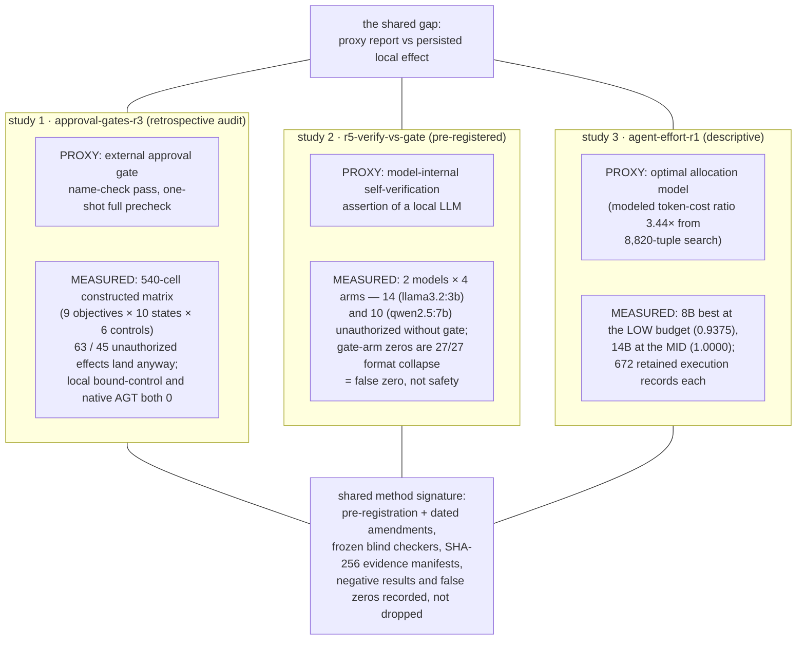

# Agent Proxy Audit

[](https://github.com/aidless/agent-proxy-audit/actions/workflows/static-checks.yml)

**Do verification signals agree with what actually happened?**

Three linked studies measure one gap: between *proxy reports* (approval-gate outputs, model self-verification assertions, resource-allocation models) and *persisted local effects*. Every guard studied here can report success while unauthorized effects land anyway — and a model asserting "I verified this" is just another proxy.

The three studies and how they relate (drawn from the table below; each proxy is a different layer, the measured side is always persisted local state):



| Study | Question | Headline result | Status | Repo |
|---|---|---|---|---|
| **approval-gates-r3** | Do external approval gates' clean reports match persisted effects? | 540-cell constructed matrix (9 objectives × 10 states × 6 controls): name-check passes **63** unauthorized effects, one-shot full precheck **45**; local bound-control and native AGT both **0** | retrospective audit; independent retro grade 6.2/10, not submitted | [approval-gates-r3](https://github.com/aidless/approval-gates-r3) |
| **r5-verify-vs-gate** | Does model-internal self-verification agree with persisted effects? | Pre-registered 2 models × 4 arms: without gate, **14** (llama3.2:3b) / **10** (qwen2.5:7b) unauthorized effects; with self-verification, **0** — but llama's zeros are **27/27 format collapse = false zero, not safety** | pre-registered (`PROTOCOL_R5.md`; `CLAIM_LEDGER.md` C200–C234, every claim carries a source path) | [r5-verify-vs-gate](https://github.com/aidless/r5-verify-vs-gate) |
| **agent-effort-r1** | Does an optimal allocation model describe a bounded tool-using agent? | 8,820-tuple allocation search gives a modeled token-cost ratio **3.44×**; measured peaks diverge — 8B best at the *low* budget (**0.9375**), 14B at the *mid* (**1.0000**); 672 retained execution records each | descriptive; assumptions and measurements explicitly separated | [agent-effort-r1](https://github.com/aidless/agent-effort-r1) |

## Shared method signature

- Pre-registration with **dated amendments** (R5) instead of silent protocol edits
- **Frozen blind checkers** and independent re-reads of persisted state
- SHA-256 evidence manifests; claim ledgers where every number names its source file
- **Negative results and false zeros recorded, not dropped** — r5 distinguishes "verified safe" from "output collapsed into an unparseable format that trivially shows zero effects"

## Scope

Finite authored local-effect measurements. Not a defense, not a population safety trial, not deployment validation. Each repo's protocol/README states its own interpretation limits; numbers above are quoted with their sources in the linked repos.

## Pilot replications of 2026 work (Oct 2026)

Two recent papers measure adjacent gaps — a harness deciding success when state
cannot be re-observed (arXiv:2610.26632), and deletion leaving residue in an
agent's derived memory (arXiv:2610.31366). [`replications/2026-10-harness-and-deletion/`](replications/2026-10-harness-and-deletion/)
contains close readings of those two plus two related papers, and pilot
replications on local Qwen2.5-7B with the scripts and raw records.

Headline pilot results: truncating a window cost success **0/6** when the fact
was not recoverable and **6/6** when it was; deleting a source record still left
the secret recoverable **20/20**, against **0/20** in a matched never-exposed
world and **0/20** after provenance closure. These are pilot-scale replications,
not the published protocols — the folder states what does and does not
replicate.

A second set of pilots tests memory mechanisms from `ai-memory` and `Hy-Memory`:
access-weighted decay extends retention only from 81 to 119 days (and does
nothing at the eviction margin under a 180-day half-life); a 50-pair × 3-model
conflict test found the conservative rule rejected **1/90** parallel pairs but
missed **16/60** true continuations, while the permissive rule caught
**58/60** and merged **29/90**; and a 50-profile deletion test found an
extractive summary preserved the deleted secret **50/50**, while a model-written
summary retained it only **2/50** and recovered **1/50**. See
[`replications/2026-10-memory-pilots/`](replications/2026-10-memory-pilots/) and
the comparison in [`docs/related-systems-2026-10.md`](docs/related-systems-2026-10.md).

**Write-up:** [Same conservative prompt, three operating points](docs/blog/2026-10-conservative-prompt-operating-points.md).
Datasets (CC BY 4.0): [conflict pairs](replications/2026-10-memory-pilots/data/conflict_pairs_50.json) ·
[deletion profiles](replications/2026-10-memory-pilots/data/deletion_profiles_50.json).

## Reproduce

Each repo is self-contained and its core tables recompute offline (Python 3.11+, no model or network required for the descriptive tables):

```bash
# approval-gates-r3 — descriptive tables + fresh 540-cell matrix
python3 scripts/make_descriptive_tables.py

# r5-verify-vs-gate — claim ledger with per-claim source paths
# see PROTOCOL_R5.md and CLAIM_LEDGER.md (C200–C234)

# agent-effort-r1 — allocation model vs retained execution records
# see README "What is measured vs assumed"
```

## Install / Quickstart

This repository has **zero third-party runtime dependencies** — `requirements.txt`
documents that every import in the 8 (now 9) Python files resolves to the standard
library or to a module inside this repo. To get a usable copy:

```bash
# no pip install needed; clone and run offline
git clone https://github.com/aidless/agent-proxy-audit.git
cd agent-proxy-audit
python3 --version   # 3.11+ (README states this requirement)

# verify the committed pilot records re-aggregate offline (no model/network)
python3 replications/bench_reaggregate.py
```

Quickstart — the fastest way to see the repo's value is to re-aggregate the
committed pilot results and confirm the README's headline numbers reproduce:

```bash
python3 replications/bench_reaggregate.py
# 结果文件 7 个，共 724 行 → 重新聚合与已提交 summary 一致（0 不一致）
```

## Verification of this repository

This repository aggregates results from linked repos. The committed pilot
records here can be checked offline:

```bash
# all replication JSON parses
python3 - <<'CHECK'
import json, pathlib
for path in pathlib.Path("replications").rglob("*.json"):
    json.loads(path.read_text())
    print(path)
CHECK

# every replication script compiles
python3 -m compileall -q replications

# result-file hashes
find replications -type f \( -name '*.json' -o -name '*.csv' \) -print0 \
  | sort -z | xargs -0 sha256sum
```

## License

Code: MIT ([`LICENSE`](LICENSE)). Synthetic data and write-ups: CC BY 4.0 ([`DATA_LICENSE.md`](DATA_LICENSE.md)).

---
*Author: Zewen Liu (Independent Researcher) · [github.com/aidless](https://github.com/aidless)*
